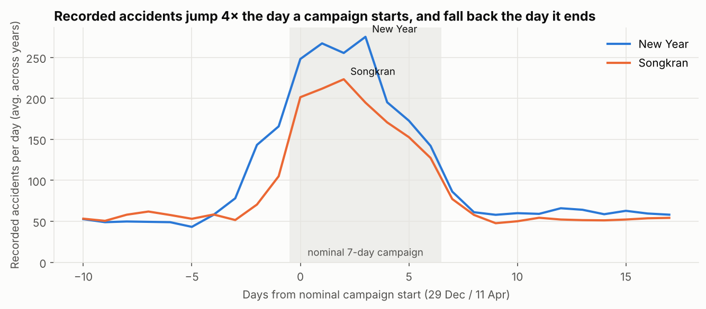
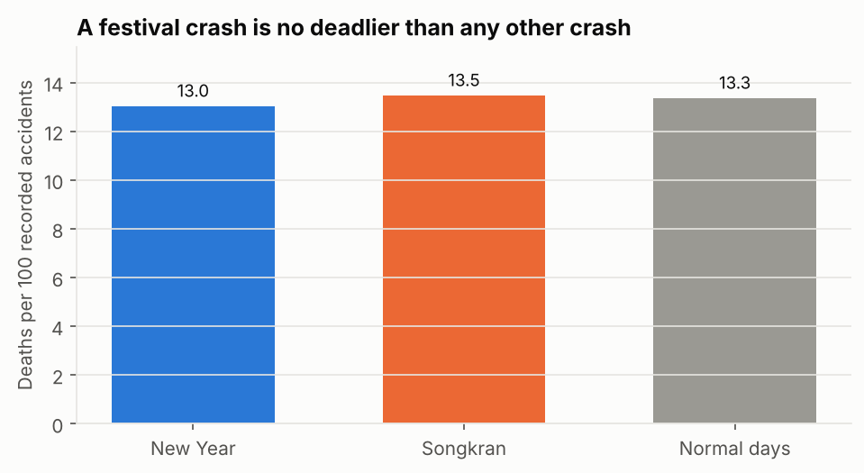
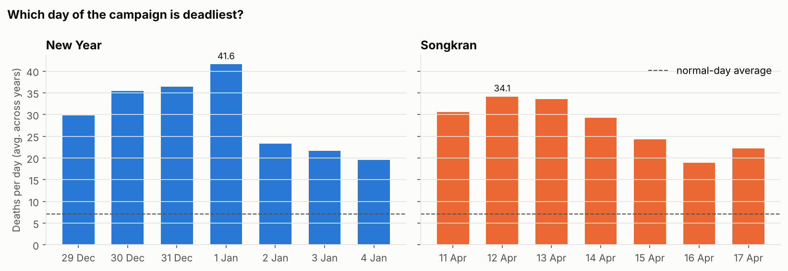
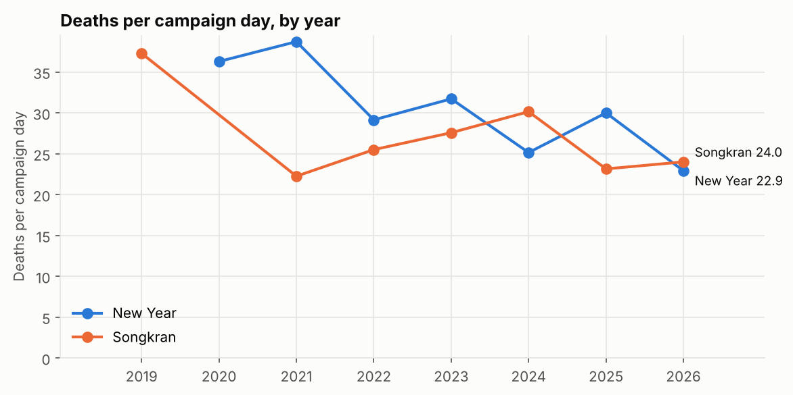
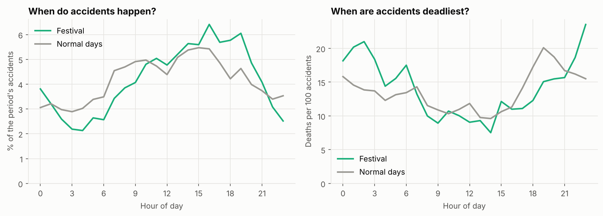
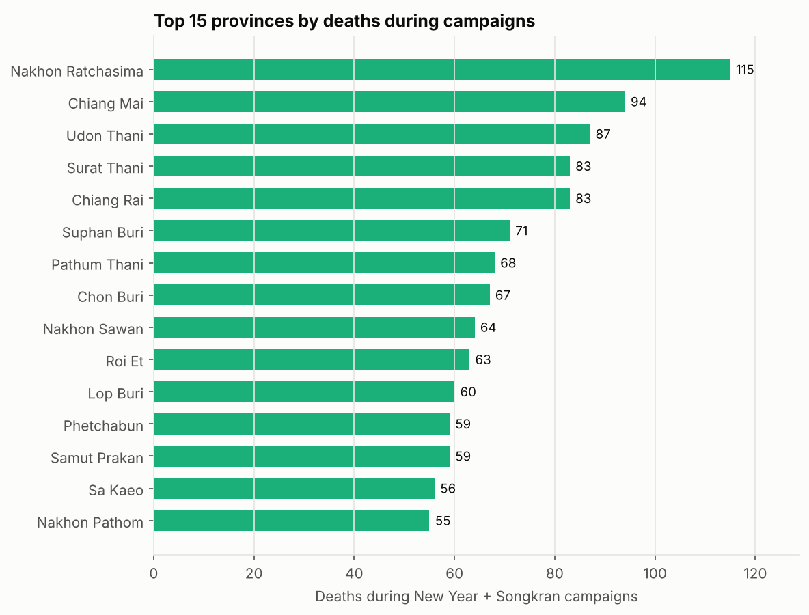
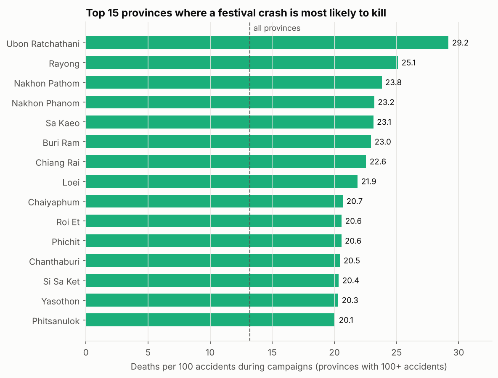
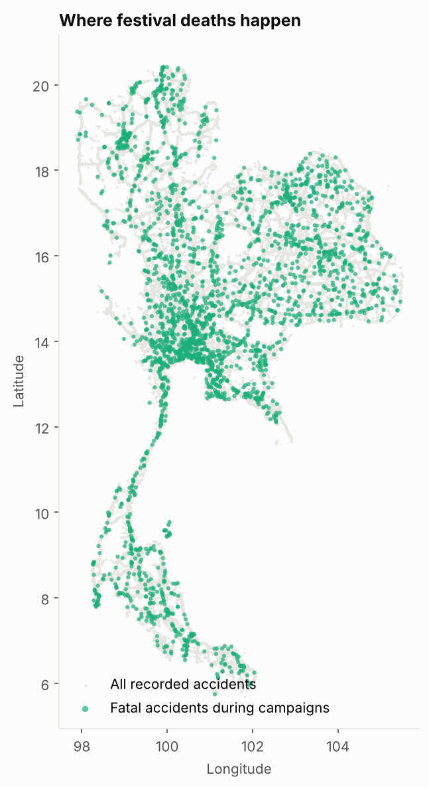
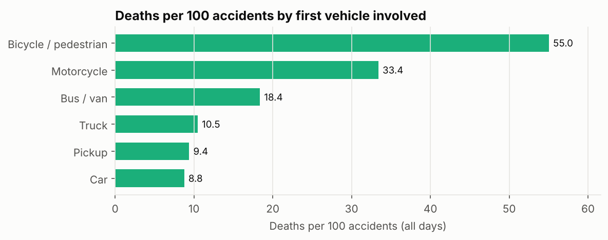
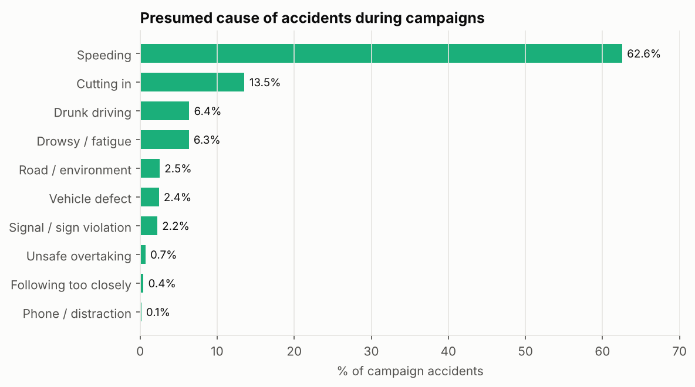

# Road accidents during Songkran and New Year on Thailand's national road network

Source: Ministry of Transport accident records (agencies: กรมทางหลวง, กรมทางหลวงชนบท, การทางพิเศษแห่งประเทศไทย), open data portal datagov.mot.go.th. After cleaning: 168,300 accidents, 22,430 deaths and 139,078 injuries from 2019-01-01 to 2026-10-12 in 77 provinces.

> Generated by `python -m roadsafety.report`. Every number below is computed from the data.

## Key findings

1. **The festival numbers are partly a recording effect.** On campaign days the data holds 201–230 accidents a day against 53 on normal days, but the jump happens exactly on the day a campaign starts (about 3.8× overnight) and reverses the day it ends. Rural-roads (DRR) records rise from 4% to 14% of all records and drunk driving from 0.8% to 6.4% of causes, which points to more intensive reporting during the "7 dangerous days" campaigns. Raw festival-vs-normal ratios should not be read as risk ratios.
2. **Per crash, festivals are not deadlier.** Deaths per 100 recorded accidents: New Year 13.0, Songkran 13.5, Normal days 13.3. Whatever the true rise in crashes is (see 1), each crash is no more likely to kill.
3. **The deadliest days are the days around the holiday itself:** 1 Jan for New Year (41.6 deaths a day); 12 Apr for Songkran (34.1 deaths a day). The last days of each campaign are the quietest.
4. **Deaths per campaign day are falling:** New Year 2020–2021 averaged 37.5 a day, 2025–2026 averaged 26.5 (-29%); Songkran 2019–2021 averaged 29.8 a day, 2025–2026 averaged 23.6 (-21%). Songkran 2020 was cancelled and 2020–2021 travel was limited by COVID-19 measures, so read the early years with care.
5. **Early evening is busiest, night is deadliest.** During campaigns 18% of accidents happen between 16:00 and 19:00, but a crash between 22:00 and 04:00 kills 19.9 people per 100 accidents against 9.9 during the day (08:00–17:00) and 15.0 at night on normal days.
6. **Motorcycles:** 38% of campaign accidents (vs 12% on normal days) and 33.4 deaths per 100 accidents, 3.8× the rate for cars.
7. **Five provinces account for 16% of campaign deaths:** Nakhon Ratchasima (นครราชสีมา), Chiang Mai (เชียงใหม่), Udon Thani (อุดรธานี), Surat Thani (สุราษฎร์ธานี), Chiang Rai (เชียงราย). Where a festival crash is most likely to kill: Ubon Ratchathani (อุบลราชธานี), Rayong (ระยอง), Nakhon Pathom (นครปฐม), Nakhon Phanom (นครพนม), Sa Kaeo (สระแก้ว).

## 1. Are festival days really 4× more dangerous?

Average recorded accidents per day around the nominal campaign start, all years together. Real traffic does not quadruple overnight and fall back overnight a week later; recording practice does. During campaigns the agencies collect accident reports far more completely (for example from rural roads), so the normal-day records are an undercount compared with the campaign records.

Because campaign dates move a little each year (and Songkran 2020 was cancelled), the campaign days used below are **detected from that step in the data**: a day in the festival season with at least 1.8× the 29-day rolling median, in a run of four days or more.

| period | festival_year | start | end | days | accidents | deaths | deaths_per_day | deaths_per_100_accidents |
|---|---:|---|---|---:|---:|---:|---:|---:|
| Songkran | 2019 | 11 Apr 2019 | 17 Apr 2019 | 7 | 1,588 | 261 | 37.3 | 16.4 |
| New Year | 2020 | 27 Dec 2019 | 02 Jan 2020 | 7 | 1,999 | 254 | 36.3 | 12.7 |
| New Year | 2021 | 29 Dec 2020 | 04 Jan 2021 | 7 | 1,753 | 271 | 38.7 | 15.5 |
| Songkran | 2021 | 09 Apr 2021 | 16 Apr 2021 | 8 | 1,510 | 178 | 22.2 | 11.8 |
| New Year | 2022 | 29 Dec 2021 | 04 Jan 2022 | 7 | 1,627 | 204 | 29.1 | 12.5 |
| Songkran | 2022 | 11 Apr 2022 | 18 Apr 2022 | 8 | 1,426 | 204 | 25.5 | 14.3 |
| New Year | 2023 | 29 Dec 2022 | 04 Jan 2023 | 7 | 1,479 | 222 | 31.7 | 15.0 |
| Songkran | 2023 | 11 Apr 2023 | 17 Apr 2023 | 7 | 1,389 | 193 | 27.6 | 13.9 |
| New Year | 2024 | 29 Dec 2023 | 04 Jan 2024 | 7 | 1,622 | 176 | 25.1 | 10.9 |
| Songkran | 2024 | 11 Apr 2024 | 17 Apr 2024 | 7 | 1,557 | 211 | 30.1 | 13.6 |
| New Year | 2025 | 27 Dec 2024 | 05 Jan 2025 | 10 | 2,121 | 300 | 30.0 | 14.1 |
| Songkran | 2025 | 11 Apr 2025 | 17 Apr 2025 | 7 | 1,492 | 162 | 23.1 | 10.9 |
| New Year | 2026 | 26 Dec 2025 | 05 Jan 2026 | 11 | 2,297 | 252 | 22.9 | 11.0 |
| Songkran | 2026 | 10 Apr 2026 | 16 Apr 2026 | 7 | 1,273 | 168 | 24.0 | 13.2 |

| period | days | accidents | deaths | accidents_per_day | deaths_per_day | deaths_per_100_accidents | accidents_vs_normal | deaths_vs_normal |
|---|---:|---:|---:|---:|---:|---:|---:|---:|
| New Year | 56 | 12,898 | 1,679 | 230.3 | 30.0 | 13.0 | 4.3× | 4.2× |
| Songkran | 51 | 10,235 | 1,377 | 200.7 | 27.0 | 13.5 | 3.8× | 3.8× |
| Normal days | 2,735 | 145,167 | 19,374 | 53.1 | 7.1 | 13.3 | 1.0× | 1.0× |

Share of records by reporting agency:

| agency | Festival | Normal days |
|---|---:|---:|
| กรมทางหลวง | 86.0% | 94.6% |
| กรมทางหลวงชนบท | 13.7% | 3.7% |
| การทางพิเศษแห่งประเทศไทย | 0.3% | 1.8% |

## 2. When: days, years and hours

## 3. Where: provinces and regions

*Burden* (total deaths) shows where most lives are lost; *severity* (deaths per 100 accidents) shows where a crash is most likely to be fatal, which points at speed, road design and how fast victims reach hospital.

| region | accidents | deaths | injuries | fatal_accidents | deaths_per_100_accidents |
|---|---:|---:|---:|---:|---:|
| Central | 7,082 | 875 | 6,998 | 800 | 12.4 |
| Northeast | 4,641 | 830 | 5,474 | 754 | 17.9 |
| South | 3,952 | 397 | 4,469 | 358 | 10.0 |
| North | 2,994 | 360 | 3,046 | 328 | 12.0 |
| East | 2,108 | 323 | 2,088 | 288 | 15.3 |
| West | 1,721 | 189 | 1,902 | 180 | 11.0 |

## 4. Why: vehicles and causes

Presumed cause is the officer's judgement at the scene and the campaign reporting forms differ from routine ones, so compare causes *within* campaigns rather than against normal days.

| cause_group | share_Festival | share_Normal days | deaths_per_100_accidents |
|---|---:|---:|---:|
| Speeding | 62.6% | 72.4% | 12.4 |
| Cutting in | 13.5% | 6.9% | 23.0 |
| Drunk driving | 6.4% | 0.8% | 23.0 |
| Drowsy / fatigue | 6.3% | 7.0% | 11.8 |
| Road / environment | 2.5% | 2.7% | 13.8 |
| Other | 2.5% | 1.9% | 17.2 |
| Vehicle defect | 2.4% | 4.1% | 6.1 |
| Signal / sign violation | 2.2% | 1.4% | 21.3 |
| Unsafe overtaking | 0.7% | 0.4% | 34.0 |
| Following too closely | 0.4% | 0.3% | 18.9 |
| Unknown | 0.3% | 1.8% | 1.5 |
| Phone / distraction | 0.1% | 0.1% | 9.4 |

## 5. Policy recommendations

1. **Measure the campaign honestly.** Headlines that compare the "7 dangerous days" with ordinary days overstate the festival effect, because recording itself jumps about 3.8×. Track year-on-year deaths per campaign day and deaths per 100 accidents instead, and record every day of the year with the campaign's completeness so the two can be compared.
2. **Move alcohol checkpoints into the night.** A campaign crash between 22:00 and 04:00 kills 19.9 per 100 against 9.9 in daytime; that is where drink-driving checkpoints and speed enforcement save the most lives. Keep traffic management on the busiest 16:00–19:00 block.
3. **Front-load resources.** The deadliest days are 1 Jan (New Year) and 12 Apr (Songkran); staff checkpoints and emergency medical teams for those days rather than spreading them evenly over the window.
4. **Motorcycles first.** With 33.4 deaths per 100 motorcycle crashes (3.8× cars) and 38% of campaign accidents, helmet enforcement, daytime-running-light checks and safe-return campaigns aimed at riders give the largest return.
5. **Two lists of provinces.** High-burden provinces (Nakhon Ratchasima, Chiang Mai, Udon Thani, Surat Thani, Chiang Rai) need the most checkpoints and ambulances; high-severity provinces (Ubon Ratchathani, Rayong, Nakhon Pathom, Nakhon Phanom, Sa Kaeo) need a review of black-spot road design and emergency response times, because their crashes turn fatal more often.
6. **Publish the data in one consistent format.** Cleaning these files meant handling 25,031 completely empty rows, 47,668 dates stored as Excel serial numbers, 2,940 dates with day and month swapped, 1,723 duplicate records, three different date formats and three header layouts. One schema with ISO dates (YYYY-MM-DD) and a stable accident ID across years would make this data far cheaper to use.

## 6. Data cleaning log

| step | rows_affected | note | file |
|---|---:|---|---|
| rows read | 40,246 |  | accident2019.csv |
| completely empty rows dropped | 21,052 |  | accident2019.csv |
| slash dates read as day/month/year | 19,194 | order detected from values whose day part is above 12 | accident2019.csv |
| incident date before report date fixed by swapping day/month | 0 | only the incident-date column was swapped; the report date is consistent | accident2019.csv |
| unparseable dates -> dropped | 0 |  | accident2019.csv |
| missing or invalid time -> hour left blank | 0 |  | accident2019.csv |
| date's year differs from the 'year' column (kept, date wins) | 0 |  | accident2019.csv |
| province names rewritten to canonical form | 377 | prefixes like 'จ.', English names, nicknames such as กทม/โคราช | accident2019.csv |
| fatalities: blank -> 0 | 0 | a blank casualty cell means none were recorded | accident2019.csv |
| injuries: blank -> 0 | 0 | a blank casualty cell means none were recorded | accident2019.csv |
| latitude/longitude swapped back | 0 |  | accident2019.csv |
| coordinates outside Thailand -> blank | 2 |  | accident2019.csv |
| duplicate rows removed | 0 | key: all columns | accident2019.csv |
| rows kept | 19,194 |  | accident2019.csv |
| rows read | 21,239 |  | accident2020.csv |
| completely empty rows dropped | 0 |  | accident2020.csv |
| slash dates read as month/day/year | 21,238 | order detected from values whose day part is above 12 | accident2020.csv |
| Excel serial-number dates converted | 1 |  | accident2020.csv |
| incident date before report date fixed by swapping day/month | 0 | only the incident-date column was swapped; the report date is consistent | accident2020.csv |
| unparseable dates -> dropped | 0 |  | accident2020.csv |
| missing or invalid time -> hour left blank | 0 |  | accident2020.csv |
| date's year differs from the 'year' column (kept, date wins) | 0 |  | accident2020.csv |
| province names rewritten to canonical form | 386 | prefixes like 'จ.', English names, nicknames such as กทม/โคราช | accident2020.csv |
| fatalities: blank -> 0 | 0 | a blank casualty cell means none were recorded | accident2020.csv |
| injuries: blank -> 0 | 0 | a blank casualty cell means none were recorded | accident2020.csv |
| latitude/longitude swapped back | 1 |  | accident2020.csv |
| coordinates outside Thailand -> blank | 1 |  | accident2020.csv |
| duplicate rows removed | 0 | key: ACC_CODE where present, otherwise all columns | accident2020.csv |
| rows kept | 21,239 |  | accident2020.csv |
| rows read | 20,062 |  | accident2021.csv |
| completely empty rows dropped | 0 |  | accident2021.csv |
| slash dates read as month/day/year | 20,062 | order detected from values whose day part is above 12 | accident2021.csv |
| incident date before report date fixed by swapping day/month | 0 | only the incident-date column was swapped; the report date is consistent | accident2021.csv |
| unparseable dates -> dropped | 0 |  | accident2021.csv |
| missing or invalid time -> hour left blank | 0 |  | accident2021.csv |
| date's year differs from the 'year' column (kept, date wins) | 0 |  | accident2021.csv |
| province names rewritten to canonical form | 435 | prefixes like 'จ.', English names, nicknames such as กทม/โคราช | accident2021.csv |
| fatalities: blank -> 0 | 0 | a blank casualty cell means none were recorded | accident2021.csv |
| injuries: blank -> 0 | 0 | a blank casualty cell means none were recorded | accident2021.csv |
| latitude/longitude swapped back | 0 |  | accident2021.csv |
| coordinates outside Thailand -> blank | 0 |  | accident2021.csv |
| duplicate rows removed | 0 | key: ACC_CODE where present, otherwise all columns | accident2021.csv |
| rows kept | 20,062 |  | accident2021.csv |
| rows read | 20,566 |  | accident2022.csv |
| completely empty rows dropped | 0 |  | accident2022.csv |
| slash dates read as month/day/year | 20,566 | order detected from values whose day part is above 12 | accident2022.csv |
| incident date before report date fixed by swapping day/month | 2,469 | only the incident-date column was swapped; the report date is consistent | accident2022.csv |
| unparseable dates -> dropped | 0 |  | accident2022.csv |
| missing or invalid time -> hour left blank | 0 |  | accident2022.csv |
| date's year differs from the 'year' column (kept, date wins) | 0 |  | accident2022.csv |
| province names rewritten to canonical form | 373 | prefixes like 'จ.', English names, nicknames such as กทม/โคราช | accident2022.csv |
| fatalities: blank -> 0 | 0 | a blank casualty cell means none were recorded | accident2022.csv |
| injuries: blank -> 0 | 0 | a blank casualty cell means none were recorded | accident2022.csv |
| latitude/longitude swapped back | 0 |  | accident2022.csv |
| coordinates outside Thailand -> blank | 0 |  | accident2022.csv |
| duplicate rows removed | 0 | key: ACC_CODE where present, otherwise all columns | accident2022.csv |
| rows kept | 20,566 |  | accident2022.csv |
| rows read | 23,841 |  | accident2023.csv |
| completely empty rows dropped | 0 |  | accident2023.csv |
| slash dates read as month/day/year | 23,841 | order detected from values whose day part is above 12 | accident2023.csv |
| incident date before report date fixed by swapping day/month | 127 | only the incident-date column was swapped; the report date is consistent | accident2023.csv |
| unparseable dates -> dropped | 0 |  | accident2023.csv |
| missing or invalid time -> hour left blank | 0 |  | accident2023.csv |
| date's year differs from the 'year' column (kept, date wins) | 0 |  | accident2023.csv |
| province names rewritten to canonical form | 434 | prefixes like 'จ.', English names, nicknames such as กทม/โคราช | accident2023.csv |
| fatalities: blank -> 0 | 0 | a blank casualty cell means none were recorded | accident2023.csv |
| injuries: blank -> 0 | 0 | a blank casualty cell means none were recorded | accident2023.csv |
| latitude/longitude swapped back | 0 |  | accident2023.csv |
| coordinates outside Thailand -> blank | 4 |  | accident2023.csv |
| same ACC_CODE with swapped day/month -> kept the copy matching neighbouring codes | 344 |  | accident2023.csv |
| duplicate rows removed | 1,702 | key: ACC_CODE where present, otherwise all columns | accident2023.csv |
| rows kept | 22,139 |  | accident2023.csv |
| rows read | 23,952 |  | accident2024.csv |
| completely empty rows dropped | 0 |  | accident2024.csv |
| Excel serial-number dates converted | 23,952 |  | accident2024.csv |
| Excel day-fraction times converted | 23,952 | e.g. 0.3403 -> 08:10 | accident2024.csv |
| unparseable dates -> dropped | 0 |  | accident2024.csv |
| missing or invalid time -> hour left blank | 0 |  | accident2024.csv |
| date's year differs from the 'year' column (kept, date wins) | 0 |  | accident2024.csv |
| province names rewritten to canonical form | 418 | prefixes like 'จ.', English names, nicknames such as กทม/โคราช | accident2024.csv |
| fatalities: blank -> 0 | 0 | a blank casualty cell means none were recorded | accident2024.csv |
| injuries: blank -> 0 | 0 | a blank casualty cell means none were recorded | accident2024.csv |
| latitude/longitude swapped back | 0 |  | accident2024.csv |
| coordinates outside Thailand -> blank | 0 |  | accident2024.csv |
| duplicate rows removed | 0 | key: ACC_CODE where present, otherwise all columns | accident2024.csv |
| rows kept | 23,952 |  | accident2024.csv |
| rows read | 23,715 |  | accident2025.csv |
| completely empty rows dropped | 0 |  | accident2025.csv |
| Excel serial-number dates converted | 23,715 |  | accident2025.csv |
| unparseable dates -> dropped | 0 |  | accident2025.csv |
| missing or invalid time -> hour left blank | 0 |  | accident2025.csv |
| date's year differs from the 'year' column (kept, date wins) | 0 |  | accident2025.csv |
| province names rewritten to canonical form | 418 | prefixes like 'จ.', English names, nicknames such as กทม/โคราช | accident2025.csv |
| fatalities: blank -> 0 | 0 | a blank casualty cell means none were recorded | accident2025.csv |
| injuries: blank -> 0 | 0 | a blank casualty cell means none were recorded | accident2025.csv |
| latitude/longitude swapped back | 1 |  | accident2025.csv |
| coordinates outside Thailand -> blank | 1 |  | accident2025.csv |
| duplicate rows removed | 0 | key: ACC_CODE where present, otherwise all columns | accident2025.csv |
| rows kept | 23,715 |  | accident2025.csv |
| rows read | 21,433 |  | accident2026.csv |
| completely empty rows dropped | 3,979 |  | accident2026.csv |
| slash dates read as day/month/year | 17,454 | order detected from values whose day part is above 12 | accident2026.csv |
| incident date before report date fixed by swapping day/month | 0 | only the incident-date column was swapped; the report date is consistent | accident2026.csv |
| unparseable dates -> dropped | 0 |  | accident2026.csv |
| missing or invalid time -> hour left blank | 0 |  | accident2026.csv |
| date's year differs from the 'year' column (kept, date wins) | 0 |  | accident2026.csv |
| province names rewritten to canonical form | 0 | prefixes like 'จ.', English names, nicknames such as กทม/โคราช | accident2026.csv |
| fatalities: blank -> 0 | 0 | a blank casualty cell means none were recorded | accident2026.csv |
| injuries: blank -> 0 | 0 | a blank casualty cell means none were recorded | accident2026.csv |
| latitude/longitude swapped back | 0 |  | accident2026.csv |
| coordinates outside Thailand -> blank | 0 |  | accident2026.csv |
| duplicate rows removed | 21 | key: all columns | accident2026.csv |
| rows kept | 17,433 |  | accident2026.csv |
| duplicates across files removed | 0 |  | (all) |

## Limitations

- Covers roads managed by the Ministry of Transport (Department of Highways, Department of Rural Roads, Expressway Authority). Municipal and local roads, where many motorcycle crashes happen, are not included, so these are not national totals.
- Deaths are those recorded at the scene or at report time; the 30-day death count used by WHO is higher.
- Recording completeness differs between campaign and normal days (section 1); ratios between them are upper bounds.
- Presumed cause groups were assigned by keyword rules (`roadsafety/clean.py`); treat cause shares as indicative.
- Province totals reflect highway length and traffic as well as risk.